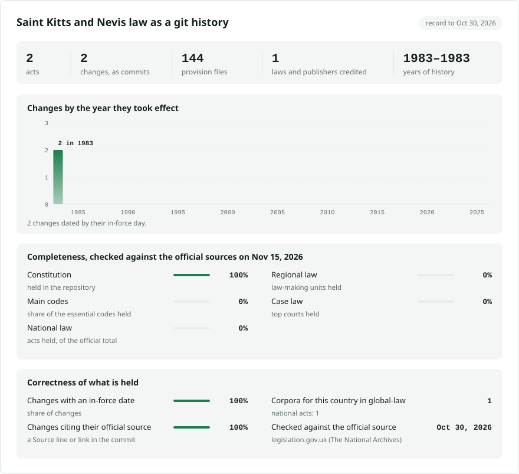

# Saint Kitts and Nevis: law history in git

<picture>
<source media="(prefers-color-scheme: dark)" srcset="data/effort-dark.svg">

</picture>

The law of Saint Kitts and Nevis as a git history: one file per section, one commit per version on the day it took effect, and the law that made each change as the commit's author. `git blame` names who is credited with every line; `git log` lists every change to a section; picking a date gives the text in force that day.

Part of [lexifina/global-law](https://github.com/lexifina/global-law), one git history for every country's law: this is Saint Kitts and Nevis' national law, which global-law reads at `saint-kitts-and-nevis/national/acts/`.

**What is in it now:** the Saint Christopher and Nevis Constitution Order 1983 (SI 1983/881) as made, in two parts (`constitution/`, `constitution-order/`); 22 chapters of the Laws of Saint Christopher and Nevis, Revised Edition, under `laws/` and 2 Nevis Ordinance chapters under `nevis/laws/`, each as at the day its title page gives (2002, 2009, 2017 or 2020); 4 Acts as passed under `acts/` and 3 statutory rules and orders under `statutory-rules-and-orders/`. These 31 were taken from copies of the Government's own PDFs held by FAOLEX and WIPO Lex. [STRUCTURE.md](STRUCTURE.md) gives the layout and the dating rules; [`data/held.json`](data/held.json) lists the 49 texts found but not taken, and why. No amendment made since 1983 is applied to the Constitution.

Each act is a folder with one file per section or schedule and a `README.md` listing its provisions: `constitution/sec-012.md` is section 12 of the Constitution (freedom of expression), `constitution-order/sched2-para-01.md` paragraph 1 of the Order's schedule 2.

The text is in English. The Constitution (`constitution/`) is the text layer of the copy of the same 1983 version held by [WIPO Lex](https://www.wipo.int/wipolex/en/legislation/details/10191), which replaced the first build's OCR in a correction commit; the rest of the Order (`constitution-order/`) was read from an image-only scan by optical character recognition (OCR) and has not been proofread in full: where the wording matters, read the [scan](https://www.legislation.gov.uk/uksi/1983/881/made). Everything else is the PDF's own text layer; Lexifina ran no OCR on it (a few older chapters carry the publisher's own OCR layer, marked in each commit's `Text-source`).

## Questions as git commands

| Question | Command |
| --- | --- |
| Every change to section 12 of the Constitution | `git log -p --word-diff -- constitution/sec-012.md` |
| Who is credited with each line of section 12? | `git blame constitution/sec-012.md` |
| Every version of the Constitution, with the day each took effect | `git log --format="%h %(trailers:key=In-force,valueonly,separator=) %an" -- constitution ':!*/README.md'` |
| Section 12 as it stood on 1 January 1984 | `python tools/on.py 1984-01-01 constitution 12` |

**Outside git**, we also host this record publicly, for free:

- **[Ask Claude about the law of Saint Kitts and Nevis](https://global-law.lexifina.com/v1/try_claude?country=saint-kitts-and-nevis)**: opens Claude with a first question ready.
- **[Ask ChatGPT](https://global-law.lexifina.com/v1/try_chatgpt?country=saint-kitts-and-nevis)**: the same question in ChatGPT.
- **[Search the law of Saint Kitts and Nevis on our site](https://lexifina.com/law?country=saint-kitts-and-nevis&q=freedom+of+expression)**: a search for "freedom of expression", with each provision's text and its versions, no account needed.
- **[Developer REST API](https://global-law.lexifina.com/v1/search_law?query=freedom+of+expression&jurisdiction=saint-kitts-and-nevis)**: the same search as JSON, with no key. See the [documentation here](https://lexifina.com/api/global-law).

Both assistants read the record through the free Global law connector (MCP, `https://global-law.lexifina.com/mcp`); the first time, the chat gives you the link that adds it. Ask in English.

**Host it yourself easily.** All it takes is git and Python, and the tools run on your machine:

```sh
git clone --depth 1 https://github.com/lexifina/global-law && cd global-law
python3 tools/countries.py add saint-kitts-and-nevis/national/acts
python3 tools/law.py show 2026-01-01 saint-kitts-and-nevis/national/acts/constitution/sec-012.md
```

Opened in Claude Code, Cursor, VS Code or Codex, the clone also starts a local MCP server with the same tools ([MCP.md](https://github.com/lexifina/global-law/blob/main/MCP.md)).

## Dates

Each commit is dated at noon, America/St_Kitts, on the day the version took effect, and carries it in its `In-force:` trailer:

- the Constitution is dated 19 September 1983, the day it came into effect (section 3 of the Order);
- the Order's sections and its schedule 2 are dated 23 June 1983, the day the Order came into operation (section 1(2));
- with no later version in the record, any later date gives the 1983 text.

Both versions are credited to the Order that made them, `SI 1983/881` (with an address that cannot exist, `si-1983-881@nationalarchives.invalid`); the committer is Lexifina.

## How it is checked

- `tools/check_repo.py` reads every version back from git on the day it took effect and on the day before and compares it with the corpus the history was built from (its hash is in `data/corpus.sha256`): 2 versions of 2 acts, 0 mismatches.
- Every commit's trailers parse; there are no merge commits, no dates that go backwards and none in the future.
- The OCR (Tesseract 5.4, mean word confidence 95.9 percent) was checked word by word against a dictionary and on a sample of pages against the scan; the misreadings found were corrected by hand, as [`REPRODUCE.md`](REPRODUCE.md) describes.
- [vulnerabilities/](vulnerabilities/): possible drafting mistakes in this law, found by global-law's detectors and checked by hand. Not run yet.

## What it does not show

- **The current Constitution.** No amendment made since 1983 is in the record.
- **Most of the law.** Only the 31 chapters and instruments that FAOLEX and WIPO Lex hold with a usable text layer and a known day are here; Acts that come into force on a day fixed by an order not in the record are held back. The Attorney General's Chambers (lawcommission.gov.kn) publishes the laws of the Federation under terms that forbid reuse, so nothing is taken from it, and copies elsewhere that repeat its "no part may be reproduced" notice are not used. Case law is in a separate repository.
- **Parts of the Order.** The Preamble, schedule 6 to the Constitution (provisions applied with modifications to the Nevis Island Assembly) and the explanatory note are left out.
- **Headings.** The marginal notes (section headings), which the OCR could not read reliably, and the chapter and part headings are not kept.
- **Exact wording.** The text may still hold OCR misreadings (section 12 opens "12.1)" where section 1 opens "1.—(1)").

## Sources

| Source | Kind | Past versions | Notes |
| --- | --- | --- | --- |
| [legislation.gov.uk](https://www.legislation.gov.uk/uksi/1983/881/made) (The National Archives) | The Saint Christopher and Nevis Constitution Order 1983 (SI 1983/881), as made | no, the Order as made only | An image-only scan (122 pages); the text was read from it by OCR |
| [FAOLEX](https://www.fao.org/faolex/) (FAO), listed through [ECOLEX](https://www.ecolex.org/result/?type=legislation&xcountry=Saint+Kitts+and+Nevis) | Revised Edition chapters, Acts and S.R.O.s (secondary copies of the Government's PDFs) | one version each, as the copy holds it | PDF text layer; `Source-status: secondary copy` on every commit |
| [WIPO Lex](https://www.wipo.int/wipolex/en/members/profile/KN) | Revised Edition chapters and Acts on intellectual property, companies, tax, customs and telecommunications (texts supplied to WIPO) | one version each | PDF text layer; `Source-status: secondary copy` on every commit |

## Licence

See [`LICENSE`](LICENSE). The Constitution Order is public sector information from legislation.gov.uk, licensed under the Open Government Licence v3.0; the other laws are official texts of the Government of Saint Christopher and Nevis, taken from FAOLEX and WIPO Lex copies under those databases' terms; Lexifina's own contributions (the arrangement of the history, the commit messages, the tables and the tools) are dedicated to the public domain under CC0 1.0.

No AI model wrote or translated legal text, and no model runs when the history is built; an AI model wrote the scripts and made the hand corrections of OCR misreadings that [`REPRODUCE.md`](REPRODUCE.md) describes.

## Visualisations

- [visualisations/](visualisations/): charts drawn from this repository. Not drawn yet.

## More

From [lexifina/global-law](https://github.com/lexifina/global-law):

- [FEATURES.md](https://github.com/lexifina/global-law/blob/main/FEATURES.md): every feature, and what every corpus must support (`git blame`, `law.py`, the MCP tools)
- [FAQ.md](https://github.com/lexifina/global-law/blob/main/FAQ.md): questions and answers · [CONTRIBUTING.md](https://github.com/lexifina/global-law/blob/main/CONTRIBUTING.md): proposing changes · [MCP.md](https://github.com/lexifina/global-law/blob/main/MCP.md): the MCP server · [REPRODUCE.md](https://github.com/lexifina/global-law/blob/main/REPRODUCE.md): how it was built · [CHANGELOG.md](https://github.com/lexifina/global-law/blob/main/CHANGELOG.md)
- [FRESHNESS.md](https://github.com/lexifina/global-law/blob/main/FRESHNESS.md): how current each corpus is · [Monitoring](https://github.com/lexifina/global-law/tree/main/monitoring): whether updates are running · [WATCHING.md](https://github.com/lexifina/global-law/blob/main/WATCHING.md): how each official source is watched for changes
- [performance/](https://github.com/lexifina/global-law/tree/main/performance): how fast the tools are, measured
- [visualisations/](https://github.com/lexifina/global-law/tree/main/visualisations): charts and bridges across the world's law
- [Vulnerabilities](https://github.com/lexifina/global-law/tree/main/vulnerabilities): mistakes in legislation as published
